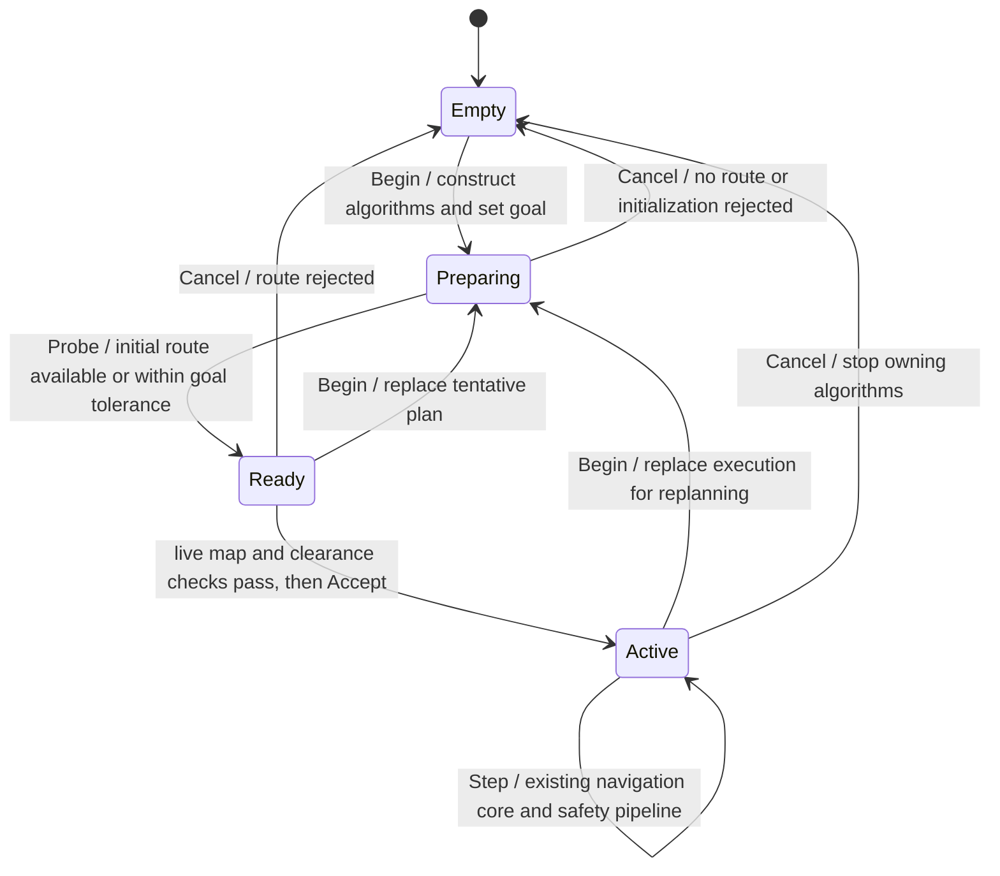

# Exploration application boundaries

This is the implemented extraction boundary, not a claim that the entire ROS
mission node has already been migrated. The node still owns the main mission
state machine, navigation acceptance orchestration and command publication.

## Targets and dependency direction

- `navigation2d_core`: existing planners/controllers and `NavigationSystem`.
  `AlgorithmRegistry` assembles implementations without changing exploration.
- `navigation2d_exploration_application`: ROS-free snapshot preparation, route
  validation, navigation session lifecycle/profiles, debug overlays, entry state, room-visit accounting, recovery
  selection, return geometry and telemetry serialization. Links core only.
- `navigation2d_exploration_io`: final artifact persistence, outside algorithms.
- `sweepnav_autonomous_explorer`: ROS adaptation and remaining mission
  orchestration. Its real target is in sweepnav's
  `simulation/online_mapping/CMakeLists.txt` and links the two extraction targets.

No file fragments, shared node pointer or writable universal Context are used.
Input views are borrowed only for synchronous calls. The ROS executor remains
single threaded; no new background workers or control scheduling are introduced.

## State ownership

`EntryCoordinator` owns the locked/pending entrance, attempt count, crawl ticks
and observation watermark. `RoomVisitLedger` owns unentered-room evidence and
per-spot visit attempts. `ReturnCoordinator` owns partial-return bookkeeping,
breadcrumb mode and return escape count. `GoalRecoverySession` preserves the
existing per-goal budget; `recovery_policy` computes body-frame decisions without
publishing commands. The node remains responsible for timing and final command
priority while its orchestration is migrated in a later step.

`NavigationTelemetry` only captures display data. The last route signature,
planning rejection reason and path margin used by decisions remain separate.

## Tentative and accepted navigation sessions

`NavigationSession` owns the concrete `NavigationSystem` and algorithm registry.
It exposes no mutable algorithm pointer and has no ROS, file-writing or clock
ownership. The existing snapshot JSON remains its initialization input; in-memory
map injection is still deferred. The node supplies local-frame pose/scan, measured
velocity and the same simulation-time seconds as before.

`Probe` retains the full `NavigationState`, with an explicit initial failure kind
(no route, start occupied, goal occupied) and the original diagnostic string.
This classification currently interprets existing backend diagnostic text; it is
not yet a structured error contract for every planner. A failed probe remains
preparing until cancelled. `Step` is rejected before acceptance and after
cancellation. Cancellation distinguishes no instance, discarded preparation and
stopped active execution; publishing a physical stop remains the adapter's job.
No asynchronous cancellation or live plugin replacement is introduced.

The node still performs live obstacle/clearance rejection and bounded retries
before `Accept`, and commits region/recovery bookkeeping afterwards. Continuous
handoff temporarily moves the previous session aside, prepares the candidate in
the moved-from object, and restores the old controller state on failure. Registry
ownership deliberately remains usable in both objects during this transaction.
No controller reconstruction, sensor integration, rejection priority or extra
control cycle is added at acceptance. Plugin factories are injectable at this
session boundary as well as at the core constructor.

## Display-only overlays

`debug_overlay` paints the planning-input and inflated grids into adapter-owned
buffers, without allocation in those functions. ROS message construction, stamps
and publication remain in the node. Unknown cells remain unknown under inflation;
under-body display free space does not modify the observation or execution mask.
Frontier debug JSON preserves its schema, decimal formatting, order and original
4000-cell sampling stride. These outputs carry no navigation authority.

## Planning evidence and memory

`BuildPlanningSnapshot` returns `PreparedSnapshot`: temporary processed cells
plus a `PlanningSnapshot` containing geometry, map revision, trail budget and
an evidence mask. The session builder reuses the original mask allocation and
trail-set buckets across plans; input views do not copy scans. The node keeps only the latter after serializing the existing
navigation JSON. This preserves the original temporary map lifetime instead
of adding a permanently retained full map.

Raw mapper cells come from `FrontierExplorer::observation_map()` as a const
reference, avoiding an additional whole-map copy at the adapter boundary.
`ScanEvidenceView` borrows the ROS float ranges without allocating a converted
array. The builder preserves body disks, ray interiors, doorway unknown-space
handling and mode-specific driven-trail evidence. `RouteCutsMappedObstacle`
uses the same snapshot geometry/mask, with unchanged planning-vs-execution
radii and current-scan handling.

## Pluggable algorithms

`AlgorithmRegistry` registers independently owned planner/controller factories.
The built-in registry is immutable; to extend it, copy it during application
assembly, register implementations, and pass the resulting const shared registry
to the three-argument `NavigationSystem` constructor. Do not mutate a registry
once shared with live sessions. Null factories, duplicate/empty identifiers and
unknown selections are rejected. Controller input requirements can be checked
with `AlgorithmRequirements`; planners declare smoothing and existing grid
fallback capabilities so navigation does not identify these by algorithm name.

Existing constructors and `MakeGlobalPlanner` remain compatible. Algorithm
factories run during initialization/replanning, not inside controller `Compute`.
The original controller reconstruction on a new route is deliberately preserved.
Use `planner_id()` and `controller_id()` for implementation identifiers; the
existing backend enum is solver telemetry, not a complete plugin identity.

The exploration ROS node exposes startup-only parameters:

| Purpose | Global parameter/default | Local parameter/default |
| --- | --- | --- |
| Exploration | `explore.global_planner=theta_star` | `explore.local_controller=rpp` |
| Entry | `entry.global_planner=astar` | `entry.local_controller=rpp` |
| Return | `return.global_planner=theta_star` | `return.local_controller=rpp` |

Names are validated before publishers/motion are created. Changing ROS parameter
values during an active run does not hot-swap an algorithm. Dynamic loading,
per-algorithm configuration namespaces, richer path semantics, stronger plugin
output contracts and live switching are not implemented by this extraction.
The existing `NavigationConfig` remains the implementation parameter contract.
The original lattice grid fallback remains explicitly opted into by its traits.

## Verification

New tests use runtime checks that remain active in Release:

- `algorithm_registry_test`: built-in construction, 16 planner/controller smoke
  combinations on an empty map, independent custom implementations through a
  real session, invalid/duplicate/null registrations and input capabilities.
- `exploration_navigation_session_test`: acceptance gate, core command equality,
  occupied start/goal, no route, injected initialization failure, cancellation,
  moved-from reuse and rollback of continuous handoff.
- `exploration_debug_overlay_test`: unknown/occupied preservation, input immutability,
  inflation support/decay, exact frontier JSON and sampling above the display cap.
- `exploration_application_test`: profiles, safety evidence boundaries, route
  remapping, entry/retry ownership, recovery commands and return choices.
- `exploration_snapshot_replay_test`: eight frozen original-node maps and a
  byte-exact status serialization sample, with provenance in the fixtures.
- `test/test_compare_benchmarks.py`: comparison-helper behavior sensitivity.

All existing assert-based C++ tests now use `-UNDEBUG` even in Release. The four
failures this exposes were independently reproduced from the frozen original
source; they must not be hidden by disabling assertions or loosening checks.
See the parent repository's `docs/EXPLORATION_REFACTORING_STATUS.md` for evidence,
known failures and remaining acceptance work.

`tools/compare_benchmarks.py` performs A/A calibration followed by alternating
A/B paired simulator runs, retains raw results and compares full non-timing
behavior (including trace). Its timing result is limited to measured noise in
those simulator cases, not a certificate for ROS Tick or RK3399 performance.
