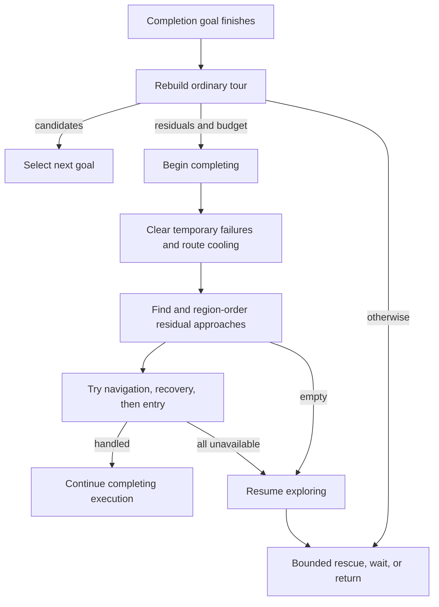
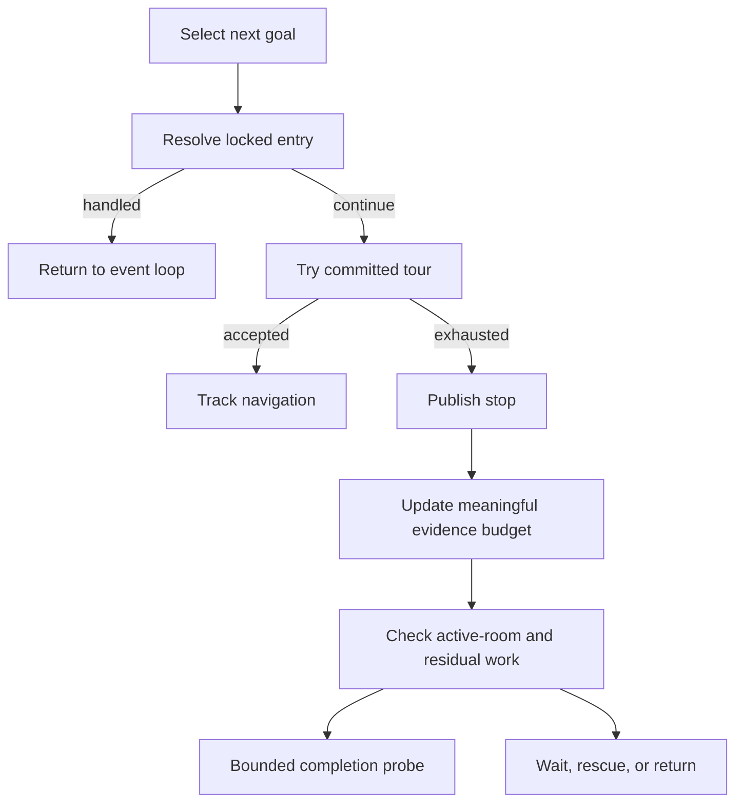
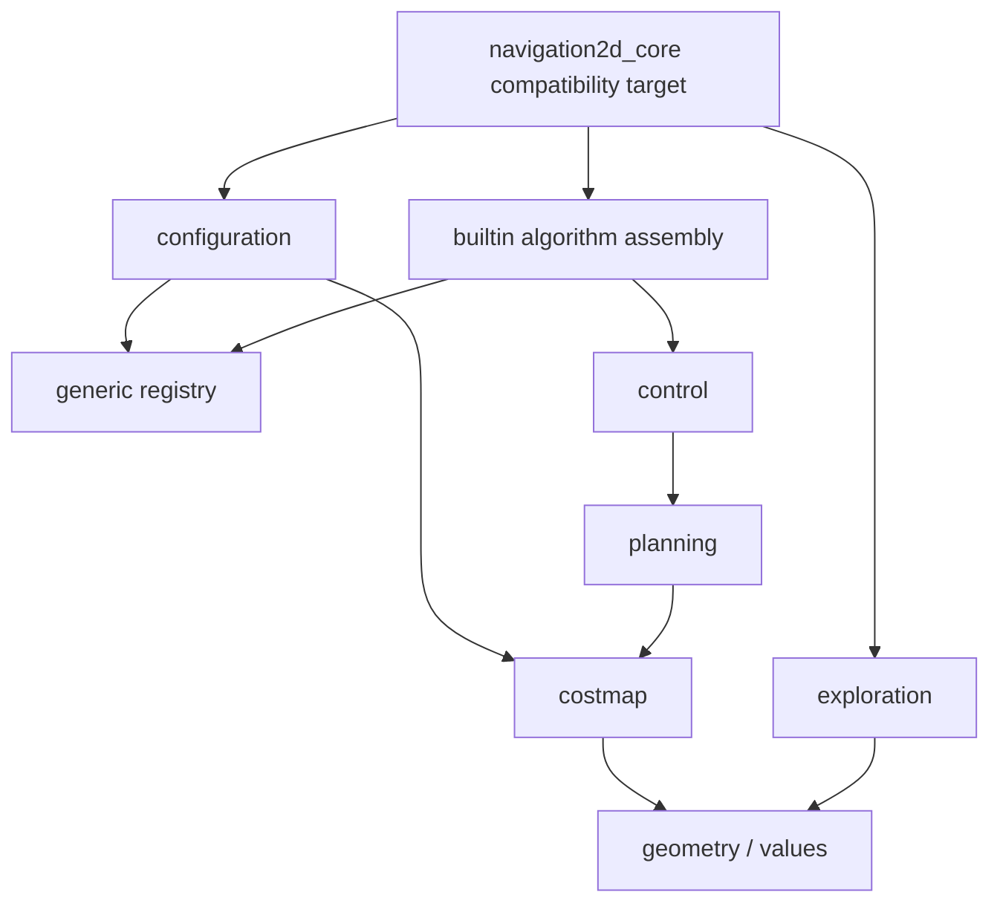
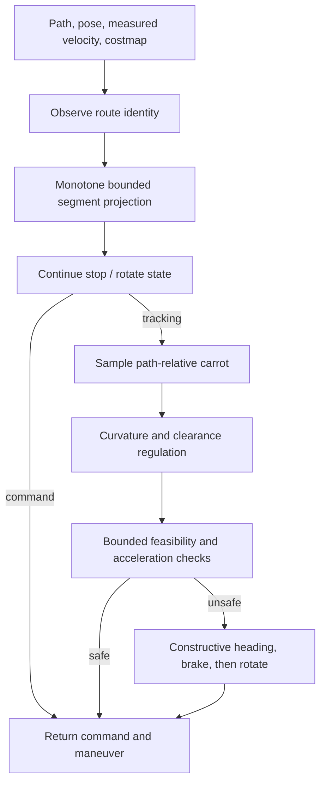
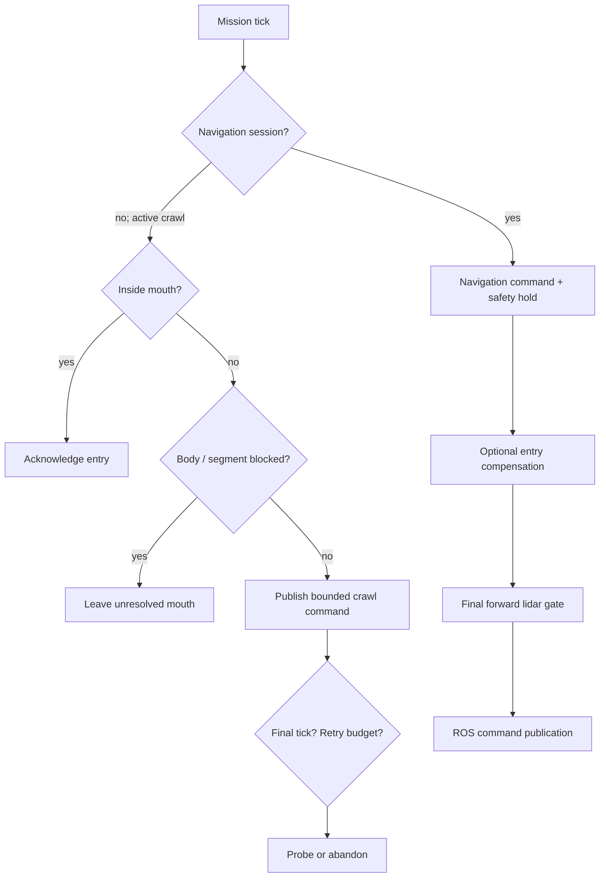
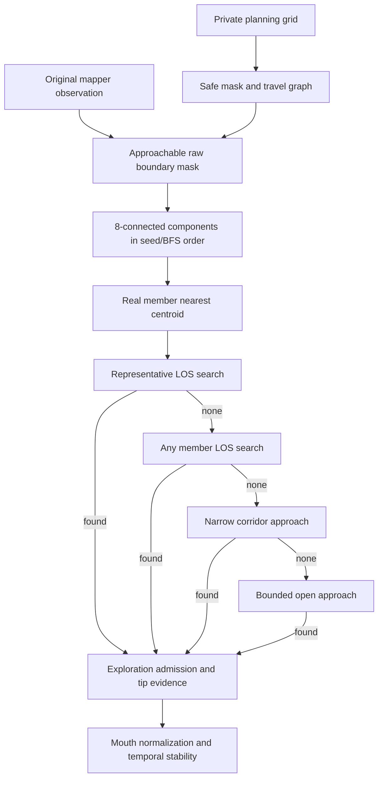
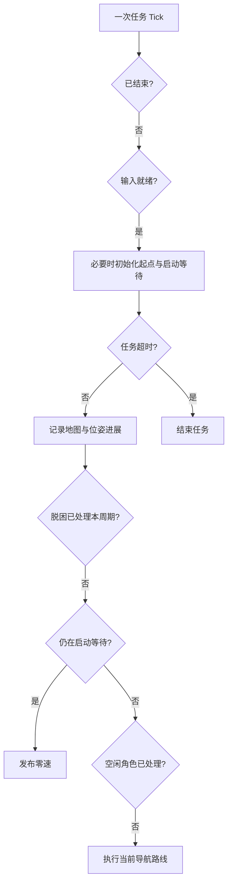
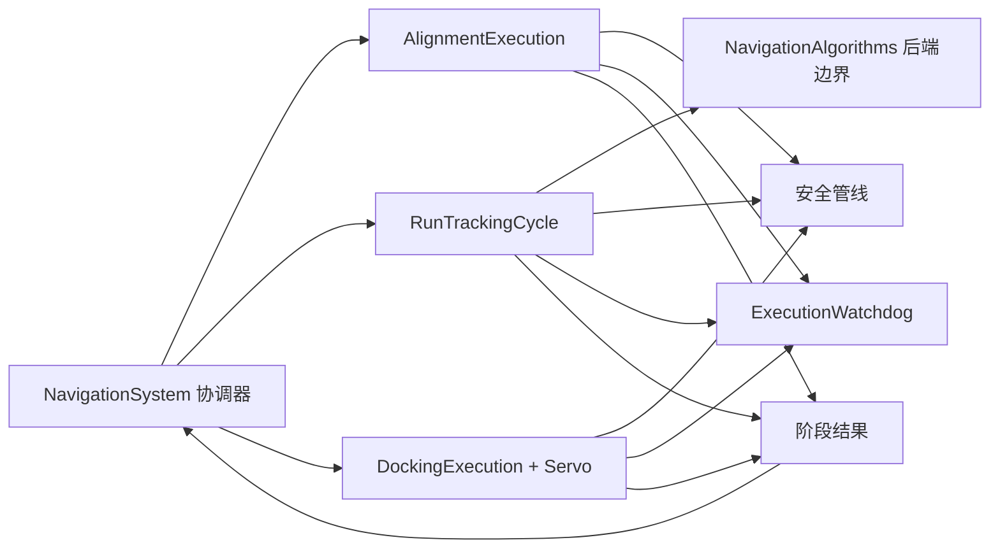

# 模块与源码索引

## 概览

```text
ROS / exploration application → navigation orchestration → planning / control
                                                      └→ costmap
configuration YAML assembly → configuration values / exploration config
planning / control / costmap → configuration values / geometry values
simulation → application（仅 benchmark / replay）
```

当前保留 navigation2d_core 聚合兼容 target；values、geometry、costmap、planning、control、
exploration、configuration、algorithm_registry 与探索应用/输出已有独立 target。
新增 navigation2d_algorithm_contracts 只依赖 costmap/值类型，承载全局与局部算法执行边界；
注册表可使用接口而不链接具体搜索器、控制器或求解 SDK。

## application

- `navigation_system.h/.cc`：产品编排入口；拥有 costmap、目标和调度状态，组合后端会话与安全链；对齐、跟踪、精停、故障提交和安全处理分别由组合角色执行，facade 提交路线/目标与周期状态。
- `navigation_algorithms.*`：独立拥有注册表、规划/控制实例与能力快照，准备路线、重置控制器及执行受校验的请求，配置只读借用。
- `navigation_execution_options.h`：每个导航实例的局部地图帧及朝向处理策略；默认保留原前进投影，可显式保留后端车体朝向。
- `application/navigation_config.h`：旧 include 兼容入口；值定义在 `configuration/navigation_config.h`。
- `navigation_config.cc`：内置选择的兼容加载入口；分组 YAML 解析、范围检查与参数描述在 `configuration/`。
- `typed_algorithm_registration.h`：外部算法专用配置解析/校验与工厂接入，不构建后端来验证参数。
- `route_preparation.*`：规划回退、角点验收、签名冷却和平滑流水线，不拥有执行状态。
- `navigation_state.h`：独立的状态/诊断值契约，旧 `navigation_system.h` 包含路径兼容；阶段模块不接收可变的导航总 Context。
- `alignment_execution.*`、`tracking_execution.*`、`docking_execution.*`：分别执行旋转对齐、后端跟踪与精停周期。精停拥有 servo；watchdog 和安全管线仍各自拥有唯一状态，通过显式调用消费事实，协调器统一提交失败效果。
- `navigation_motion.*`：按原顺序评估安全过滤，并集中投影请求/发布/停止标志；TTC 单独提交，避免改变跟踪提前返回时的诊断。
- `docking_servo.*`：精停进度/姿态迟滞与速度生成，按新目标重置；安全过滤和失败提交仍由导航编排执行。
- `command_safety_pipeline.*`：独立拥有传感器监测和动态预测；借用 Impl 内稳定寿命的配置，先动态否决后消费原始传感器观测，保留 TTC 的原调用位置。
- `execution_watchdog.*`：路线/对齐进度、旋转、安全停止计时、零命令和每目标恢复预算；组合原 CommandStallWatch，三类重置范围保持不同。
- `navigation_failure.*`：失败效果契约；显式保留进度预算耗尽不清路线、精停超时不增加恢复次数等既有语义，状态和路线仍由导航编排单独提交。
- `command_stall_watch.*`：累计位姿/路线/测量速度证据、时间窗与周期预算的唯一写入者。
- `benchmark_runner.cc`：命令行适配器，仅链接 simulation，不进入产品库。

## exploration application 与 ROS 适配

- `application/exploration/mission_lifecycle.*`：启动基准、阶段、启动等待、超时和最终返航验收；缺少回家误差使用 optional，ROS 适配保留原结果文件表示。
- `application/exploration/entry_target.*`：按门宽、已知自由深度和尝试次数选择探入窗口，不消耗预算、不提交目标。
- `entry_coordinator.*`：入口锁、证据、尝试/爬行预算和入室判断；爬行返回阻塞、行驶或最后一个命令，适配器保持先发布末命令再处理退出。
- `escape_execution.h`：脱困命令、截止时间和返航意图的单一所有者；实时雷达修正仍复用 recovery_policy。
- `pose_motion_watch.*`：独立累计位姿运动与停滞时间窗，保留慢速入室保护，不以编码器转动代替平移进展。
- `dispatch_policy.*`：初始路线净空验收、目标超时与三类同步递归重试作用域；由 NavigationDispatch 执行准备/探测/复核/接受，GoalExecution 提交目标、预算及区域状态；ROS 端口仅提供地图快照、观测和报告适配。
- `return_coordinator.*`：直返、空闲、路径故障和位姿停滞的返航执行顺序及预算；通过 ReturnActions 窄端口执行，不依赖 ROS 或共享任务 Context。
- `return_geometry.*`：只读地图上的回家落点与轨迹点计算，保留原 tie-break 和返回类型；不拥有任务状态。
- `ros/exploration/pose_feedback.*`：定位/真值反馈转换、只读当前位姿、严格超过 0.05 m 的轨迹采样与累计里程；两个订阅路径共用单一状态所有者。
- `ros/exploration/debug_paths.*`：全局/局部/tour 消息构造和显示光标状态，不发布消息、不提交目标。
- `ros/exploration/map_observation.*`：世界坐标线段对实时占用图的查询，同时供显示和爬行判断使用；不归调试模块拥有。
- `ros/autonomous_explorer_node.cc`：ROS 节点装配、坐标/时钟转换和各应用端口绑定。任务阶段、选点、目标跟踪/降级、恢复和返航的执行职责已由应用角色接管；节点仍有跨角色绑定及局部业务判断，尚未完成薄适配验收。

## costmap

- `grid_2d.*`：加载静态 occupancy grid，负责世界坐标与 cell 坐标转换。
- `layered_costmap.*`：静态层、激光障碍层、清障射线、指数膨胀、滚动窗口和碰撞查询。

## planning

- `global_planner.h`、`planner_contract.cc`：保留旧 `Plan`，新增受保护 `PlanRequest` 扩展点和不可绕过的 `PlanWithContext` 校验边界；结果带状态、帧、地图版本和朝向语义。旧异常文字只在兼容适配中转换，不能代替新后端的类型化结果。
- `execution/algorithm_budget.h`：ROS 无关的停止令牌和 steady_clock 截止时间。旧同步后端只支持调用前后检查及拒绝迟到输出，不能宣称可抢占中断。
- `dijkstra_planner.*`、`astar_planner.*`、`theta_star_planner.*`：独立全局规划策略。
- `grid_search.*`：三种策略共享的网格搜索基础设施，不解析配置字符串。
- `planner_factory.*`：旧工厂兼容入口，委托 `application/algorithm_registry.*`。
- `path_geometry.*`、`route_identity.*`、`path_metrics.*`：导航路线的几何、身份与指标。
  `path_resampling.*` 保留原 `DensifyRoute`，另有保留车体朝向、倒车和零平移旋转段的采样；保留模式不会进入切线平滑器。
  默认旧 Plan 适配器可使用历史投影，新请求后端的车体朝向不能被静默抹除。

## control

- `local_controller.h`、`controller_contract.cc`：保留旧 `Compute`，新增 `ComputeRequest`/`ComputeWithContext`；区分有效零速、刻意停止、不可行、取消、预算、输入/输出和后端错误。错误及取消不能携带运动，NaN/Inf 和“停止却返回运动”被拒绝。NavigationSystem 与探索 NavigationSession 已接入该边界；故障锁存直到显式新目标，取消清除目标，单次预算耗尽返回零速并保留可重试会话。
- `depth_observation.*`：世界帧深度轨迹、消失保持与时间过期的唯一状态所有者。
- `collision_monitor_geometry.*`：通道/外形、点相交和速度积分的无状态几何。
- `regulated_pure_pursuit.*`：路径跟踪、曲率/代价调速、加速度限制和前向碰撞预测。
- `dwa_controller.*`：低算力动态窗口速度采样、恒定控制 rollout 和多项代价评分。
- `mppi_controller.*`：控制序列采样、差速批量 rollout、critics 评分和重要性加权更新。

## geometry 与 sensor

- `geometry/pose_2d.h`：以 `Sophus::SE2d` 作为 `Pose2d`，点坐标使用 Eigen。
- `geometry/path_2d.h`、`twist_2d.h`：路径和速度值，不依赖规划/控制接口。
- `geometry/robot_geometry.*`：进程机器人几何的安装、校验与只读查询，不负责 YAML。
- `configuration/vehicle_config.*`：YAML 到机器人/探索配置的适配；旧 geometry include 保留。
- `exploration/exploration_config.h`：独立探索配置值，不拉入 FrontierExplorer。
- `sensor/observations.h`：产品输入的 `LaserScan` 和传感器坐标系 `PointCloud2d`。

## simulation

`NavigationSimulator` 生成雷达观测、积分底盘真值并注入动态障碍。它可以依赖产品核心；
产品核心禁止反向依赖 simulation。

## 验证入口

`test/replay/README.md` 说明如何从真实 ROS 可执行目标构建冻结/候选受控回放，
并通过 A/A→A/B 检查轨迹、非计时输出及性能。该回放替换发布器，不代表 DDS 或板端验收。

测试注册集中在 `test/CMakeLists.txt`，保留原断言开关、Acados/快照编译定义和二进制输出位置；根 CMake 只装配产品库与测试目录。

- `application/exploration/entry_probe_executor`：入口靠近、探测、已入室判定和证据提交的同步流程；引用现有状态所有者，不保存节点或共享可写 Context。`EntryActions` 只提供导航、冷却、房间调度和通知能力。
- `ros/exploration/entry_reporter`：入口事件的 ROS 日志与状态文案；状态发布继续经过节点出口，保持日志/发布先后顺序。

- `application/exploration/tour_execution`：唯一拥有已承诺 tour 队列及版本，向节点提供只读视图；负责构建、房间收尾、候选游标、连续交接和远端救援排序的提交。`mouth_tour_order` 与 `wall_tip_tour_order` 分别计算原有的三段/两段优先级，保留不同的区域与轨迹方向规则。

- `application/exploration/entry_completion`：统一入口确认和房间收尾的顺序，显式区分探测前、爬行、行驶中、近目标及成功/选择入口；保留 12/14 秒冷却的前后顺序，不把过门口计为区域完成。`entry_actions` 是入口能力与通知协议，不保留服务或共享可写状态。

- `application/exploration/dispatch_policy` / `navigation_dispatch`：拥有候选路线的实时占用/净空验收与有界重试顺序；显式区分接受当前准备、接受递归重试与拒绝。适配器负责记录诊断并取消准备、维护冷却签名和提交目标，失败候选不能提前提交任务状态。

- `application/exploration/planning_evidence_budget`：唯一拥有起点/已行轨迹重放意图及米制预算；地图分辨率和轨迹样本不足时保留请求，只在准备证据时消费一次。取消重放意图保留尚未消费的预算，保持原恢复语义。

- `ros/exploration/explorer_parameters`：启动时收集 ROS 参数、环境约束及结果路径，按显式算法注册表验证三种用途的选择；节点持有 const 配置，不再交错声明参数和任务操作。保留原参数/环境解析顺序与默认值，读取不构造算法实例。

### Frontier evidence and memory boundaries

`frontier_types.h` defines mapper grid and goal values without an explorer dependency.
`MapEvidence` owns observation/planning snapshots; borrowed `ObservationGridView` and
`PlanningGridView` separate raw frontier identity from execution geometry. Validated
callers supply matching grid storage and positive planning resolution. Update
notification occurs after the observation copy and before the planning move.

`FrontierTracks` owns observation epochs and representative association; duplicate
candidates in one epoch do not increase persistence. `FrontierVisitMemory` owns
temporary/persistent spatial exclusions and known-cell growth expiry.
`doorway_geometry` calculates clearance and doorway evidence; `live_route_safety`
checks body-swept route samples against occupied cells. Neither grants passage
through occupied mapper evidence. FrontierExplorer still composes extraction,
viewpoint generation and region scheduling; those stages remain to be separated.

### Completion execution

`CompletionExecution` owns residual-probe rounds and the ordering of start/finish
actions. It borrows the explorer, mission lifecycle and tour only for a synchronous
operation. `CompletionActions` supplies navigation/entry/recovery and output effects;
no ROS node or mutable mission context is retained. `completion_reporter` formats
ROS diagnostics separately. Tour interfaces expose value types and forward-declare
the explorer; implementation files include its complete API.



The direct completion replay exercises empty/residual/blocked/finish paths with
real navigation, captured outputs and an independent frozen source/header/core
baseline. Each case owns its ROS context, including early mission shutdown.
It uses the controlled explorer fixture's 0.05 m map and advances past bootstrap.
These controlled probes do not replace complete exploration or board validation.

### Goal selection ownership

`SelectLockedEntry` gates ordinary tour selection. `EntryCoordinator` owns the
mouth lock, pending target, attempts and crawl ticks. Its real-door policy keeps
a latched easy mouth valid after map flooding; live fallback checks corridor
geometry before measuring the gap. A failed probe may consume attempts or clear
the lock, so selection reads the remaining budget after the action returns.
`EntrySelectionResult` explicitly distinguishes handled work from continuing the
tour. A missing pose cannot acknowledge arrival.

`SelectionExhaustion` owns the empty/no-executable cycle counters and last
meaningful known-cell count. A 500-cell gain resets the blocked budget and
reopens residual probes; single-cell changes do not. The existing 2/3/6-cycle
wait and 12-cycle mature-empty confirmation remain unchanged. The stop command
precedes selection status and route clearing; range sensing remains lazy. The
ROS adapter owns time and publications, while the executor owns their order.
Neither executor retains action references or borrows a mutable node context.



### Frontier travel graph

`BuildFrontierTravelGraph` borrows planning and observation maps and returns an
execution-safe viewpoint mask plus discovery travel distances. It owns no map
or mission state. Safe and relaxed discovery searches keep their independent
masks, row-major nearest-start ties and four-neighbour expansion order. Relaxed
distances fill only cells unreachable in the safe graph. An absent safe start
returns `nullopt` before bootstrap.

`ApplyBootstrapFrontierTravel` handles the small-map fallback separately. It
uses raw known-free planning cells only when no observed frontier is reachable
and known coverage is below 10000 cells. It changes discovery distances, never
the safe viewpoint mask. The explorer still checks that mask before nominating
an executable goal; navigation still validates the live route. The stage moves
its result buffers and does not copy either occupancy map.

### Build dependency boundaries

`cmake/libraries.cmake` defines map, planning, control, exploration, generic
registry, configuration and builtin assembly targets. `planner_factory.cc`
belongs to builtin assembly because its compatibility functions select concrete
registered algorithms. YAML is linked by configuration; DecompUtil and Acados
remain implementation dependencies of control. Each owned implementation keeps
the existing C++20 and strict warning settings.



Consumers keep linking the CMake `navigation2d_core` target, which propagates
its dependencies. Its archive alone is no longer a complete distribution.
Domain consumers can link their specific targets directly. The registry and
configuration boundary executables verify that configuration/custom algorithm
registration can link and run without concrete planning/control backends.
Existing differential probes retain the independently frozen original monolithic
baseline (or its verified executable bundle); do not replace that baseline with
one archive from the new split. Contract manifests capture all candidate archive
digests and link order, rather than treating the facade archive as the whole
implementation.


The legacy `Grid2d::Load` definition belongs to configuration, while grid
occupancy and geometry queries stay in costmap. Standalone file consumers link
`navigation2d_configuration`; the compatibility core continues to provide it.
The loader preserves cells/rectangle parsing, override order and failures.
YAML-consuming tests declare their direct YAML dependency explicitly.

Larger `PlanningGridView` cell queries are implemented once in the exploration
library. This keeps the query code independent of mask-loop inlining after
reachability extraction. Query formulae, scan order and numerical comparisons
are unchanged. A controlled Tick regression was localized to mask generation;
its failed samples and discarded lifetime experiment remain available. The
isolated query implementation is validated before the original performance
gate is repeated; diagnostic averages alone do not close performance acceptance.

### Regulated pure pursuit ownership

The controller facade keeps only pursuit tracking parameters and composes two
state owners. `PathProgress` owns endpoint/size identity and the monotone segment
cursor; it never retains a path reference. `Alignment` owns stop/rotate/resume
hysteresis and the diagnostic maneuver. An optional command distinguishes an
owned zero stop from delegation to ordinary tracking. Nominal clearance
regulation and collision rollout are shared pure computations.

`ParametersFrom` converts the legacy configuration into the fields actually
used by pursuit. The existing public constructor remains available; YAML and
algorithm selection stay outside the controller. Empty-path intervals preserve
route state, while the original endpoint/size threshold resets it. The same
collision model validates tracking, braking and constructive forward probes.



The differential driver covers 960 frames across two radii, four maps and six
route shapes, including empty intervals and sub/above-threshold goal changes.
It compares commands, collision verdicts and all maneuver diagnostics against
independently frozen headers/core; benchmark mode must preserve the same trace.

### Viewpoint rejection and entry execution

`ViewpointRejections` owns the soft-scrape anchor/count and the single timed
viewpoint demotion. `RejectOpenWallViewpoint` owns cooling-before-mutation,
soft tour rotation and hard failure accounting. Clock conversion and logging
remain adapters; the application stores nanoseconds, without a ROS clock.

`ExecuteEntryCrawl` owns the arrival / segment check / command / retry order;
`EntryCoordinator` still owns the mouth, attempts and tick counter. The last
crawl command is published before stopping the crawl and testing retry budget.
`ExecutionCommand` owns doorway velocity compensation and the final forward
lidar body gate. Evidence is borrowed synchronously; map checks remain lazy.



These are execution boundaries, not a completed mission abstraction. The ROS
node still owns substantial selection, navigation outcome and recovery flow.

`ViewpointArrival` owns the pending active-region coverage obligation and the
near/succeeded exploration arrival flows. It rechecks attempt budget after a
probe callback, retains unresolved mouths and consumes the coverage obligation
once. Return/completion/retreat navigation success remains outside this flow.

`RetreatExecution` owns retreat purpose and the attempted-cell latch. Allowing
another attempt and finishing an active retreat are separate operations. The
executor checks the latch before reading lidar, requires Euclidean movement
through `SelectTrailRetreat`, marks purpose before dispatch, and cancels trail
evidence on rejected navigation. `GoalBehindDrivenTrail` retains the bounded
reverse trail walk independently of ROS pose/trail storage.

`GoalExecutionWatch` owns the timeout, start stamp and monotone path-progress
anchor. It reads a borrowed clock only when the original short-circuit flow
needs elapsed time. The failure predicate retains return docking exemption,
first-segment recovery, tight-front, mid-path pinch and hard forward STOP gates.
Nanosecond conversion uses division by 1e9, matching ROS Duration semantics.

### Frontier discovery and viewpoint selection

`FrontierComponents` owns only a single discovery run's boundary mask, visited
marks and row-major cursor. It borrows raw observation and travel distances to
mark approachable boundaries, then yields 8-connected components in BFS order.
`LocateCluster` chooses a real member nearest the centroid, keeping strict ties.

`FrontierViewpointProblem` is a synchronous read-only search input. Candidate
filters retain observed-free authorization, travel reachability, cooling,
standoff and clearance checks. Known-cell cooling evidence is queried at the
same points as before; this split does not introduce a gain or blacklist cache.



The four search passes have strict priority; later scores cannot replace an
accepted earlier pass. Ray gain uses 144 rays with range steps from planning
resolution and area from observation resolution. Region/tour state, admission,
tracking and debug association remain in FrontierExplorer at this checkpoint.

`FrontierReachability` borrows planning/observation geometry for bounded safe
region connectivity and reachable carved-unknown counting. They retain their
distinct clearance contracts. `SettleViewpoint` adjusts only x/y on original
free evidence, preserving goal identity, metadata, strict distance ties and
existing invalid-input guards; FrontierExplorer retains the public facade.

### Motion transport boundary

Every motion command from exploration, crawl, escape, route rejection and stop
uses `MotionOutput::Send(Twist2d)`. Policies run before the transport call. The
ROS adapter owns the publisher and maps linear/angular values to x/z without
rewriting them; the default remains `/cmd_vel` with depth 10.

The adapter round-trip test publishes only on a unique test topic. Generated
replays translate Send into the same in-memory command receiver as the frozen
node; logic-only startup also removes the publisher factory. Frozen fixture
headers remain unchanged and uncaptured output calls still reject generation.

The separate motion benchmark compares the former direct ROS conversion with
the adapter, using a matched reader on a unique test topic. It warms 16 sends,
measures 2048 sends, drains callbacks in fixed batches and reports per-send
percentiles, send/drain loop time and process peak RSS. It does not measure
robot execution, full mission scheduling or target-platform behavior.

Logic-only replay startup removes the motion publisher factory, so its unused
ROS object must also be omitted from that replay's link. Keeping it loaded an
extra typesupport dependency and caused a measured RSS regression. Captured
startup retains the object. Generation rejects a surviving factory call before
pruning, and records/hashes all explicit objects, archives and DSOs before and
after linking to detect concurrent changes. Frozen baseline bundles stay intact.

### Entry recovery and route-failure state

Entry recovery continuations distinguish peel, doorjamb STOP, retreat success
and entry stall. They borrow EntryCoordinator and retain each source's probe,
crawl, abandonment and selection order. Open-forward STOP restores a pending
mouth before its lazy clock test, excludes open-space geometry for locked
entries, and permits only one accepted open-space replan before selection.

`RouteFailureHistory` owns route cooling, the current pose-cell failure count
and map-growth anchor. Cell changes reset failures and cooling; map growth or
explicit cooling clears preserve the failure budget. Navigation gets an owned
signature snapshot, without sharing a mutable container. The legacy write-only
execution-stall total is removed; exported counters/messages remain unchanged.

### 位姿输入边界

`PoseFeedback` 在 ROS 回调中转换为 map-frame `PoseObservation`，探索逻辑只读取平面坐标、朝向和原始纳秒时间戳。缓存每次观测均更新，与累计轨迹的 5 cm 采样门槛独立；不增加时效或四元数归一化策略。

### 观测适配

`scan_observation` 显式区分同步借用的范围视图和导航独立持有的扫描副本。`map_observation::ObservedRouteCutsWall` 负责 ROS 占用值与 planning-local 路线的 map-frame 转换，再委托领域路线验证器；保持未知/49/50 阈值及无位姿回退语义。

### 入口探测计算阶段

`entry_probe_direction` 保持未知区域质心→机器人到入口→原观点到入口的轴向优先级；`EntryProbeGrid` 只借用规划/观测地图，持有同步几何视图，返回独立四邻接距离。`entry_probe_search` 先按原深度、侧向、间隙与严格评分比较选取连通候选，再执行原几何回退；`mouth_gap` 保留窄轴自由长度。没有把回退改为可达性保证，也未调整安全半径。


### 未访问空间

`FreeSpaceDistances` 在观测自由格上计算八邻接距离，保留对角代价、源点吸附顺序和可选上升场约束。`UnvisitedSpaceGoalsAt` 用轨迹距离区分尚未驶入的连通区域，再以门口种子证据授权候选，最终选取满足规划间隙的深处格。输入为同步只读视图，距离与目标返回独立值；调度器持有地图与任务状态。

### 口部任务归并与落点

`MergeMouthGoals` 按首个匹配口部稳定归并，保留获胜任务的元数据及两者最大的格数/增益证据。`PlaceMouthGoals` 将尚在接近侧的目标推进到已观测自由格；中心线搜索保留原间隙、侧向与深度评分。两阶段同步读取地图，返回独立任务序列，既不提交区域上下文也不发送控制命令。

### 剩余碎片目标

`BuildSafeFrontierTravelGraph` 复用最近安全起点与四邻接传播，仅输出严格执行图。`BestLeftoverApproach` 查询单个边界的可执行观点，`SelectLeftoverViewpoints` 排序和去重；`LeftoverSelection::raw_frontier_cells` 未赋值表示未完成计数（输入无效或无安全起点），已赋值的零表示实际没有原始边界，调度器据此保留原来的遥测更新时机。口袋/永久记忆只读借用，排序结果独立拥有。

### 同步任务转换

`TryContinuousTourHandoff` 编排连续观点交接：拒绝候选后恢复原导航会话，接受后完成任务记账与状态发布，再释放旧会话。`TryUnenteredRoomVisits` 使用独立房间尝试账本，在准备/规划前消耗次数，并保持失败次数。`ReturnCoordinator::CompleteArrival` 唯一编排已到达返航路线后的直达、面包屑和结束顺序。ROS 适配器保留发布、日志与规划入口；整体任务推进器仍待迁移。

### 近距离前方 STOP

`ExecuteForwardBlocked` 编排入口与普通观点的两种退出顺序。入口恢复 pending 后先取消导航，保留预算和队列，尝试一次脱困；普通观点先记失败、冷却八秒、推进队列并清恢复预算，再尝试脱困、取消导航和发布状态。所有可变状态仍由各自已有所有者维护；适配器仅执行同步外部效果。

### 近目标凹角退出

`ExecuteAlcoveExit` 区分仍有局部工作与耗尽分支。前者保留区域可提名性并可重试入口；后者保持三个锚点的区域冷却、退避重置、巡游取消与脱困顺序。时效分类留在调用方，日志在原副作用位置同步执行，地图/入口/队列/路线历史由各自所有者维护。

### ROS 输入与订阅生命周期

`ExplorerObservations` 独立拥有最新地图、扫描、位姿/轨迹与编码器速度；只读借用在下一次相应观测更新前有效。速度继续按 ROS 时钟的 ±200 ms 窗口返回，缺测/过期的历史零值退化语义不变。`ExplorerSubscriptions` 仅拥有订阅资源，保持原话题、QoS、单执行器和先缓存后通知顺序；销毁前调用方应停止 executor。地图应用与版本提交仍由任务侧执行，不在接收缓存里递增版本。默认定位源只订阅定位位姿；真值仅在明确评测模式启用。

受控回放通过 `ReplayObserve*` 注入相同输入，原始冻结节点仍使用原字段与独立冻结头文件/库；领域地图的 double 分辨率与版本赋值不经过 ROS float 元数据再次转换。逻辑范围剔除未使用的订阅对象，捕获端点范围保留实际订阅装配。

### 任务阶段推进

`ExplorationMission` 唯一拥有任务生命周期、起点、启动等待和阶段。`MissionLifecycle` 仅保留源码兼容别名，不复制状态。`Tick` 使用同步 `MissionRuntime` 阶段能力和已有 `MotionOutput`，不包含 ROS、输入消息缓存或可变总 Context。输入未就绪、任务结束、超时、正在脱困、启动等待、空闲调度都保持各自的提前返回；各分支按需读时钟。地图输入使用 map/world 米制位姿，时间统一为调用方纳秒时钟，预算沿用经过验证的正数秒配置。



`EscapeExecution::AfterStop` 在取消定时并同步发送零速后消费续行意图：返航优先于 peel 恢复；peel 的 resume 标志只消费一次，预算计数保留。入口、普通观点、降级、收尾和重新选择分别有明确结果。空闲与路线跟踪角色的具体实现暂留适配器，阶段接口不是整体解耦已完成的标志。

### 代价地图状态所有权

`LayeredCostmap` 组合静态图、动态障碍层、主图和变化历史。`costmap_internal::ObstacleLayer` 只拥有动态栅格；每次同步更新借用图几何及两个观测距离限制，不保留引用。`GridChangeHistory` 只记录主图实际变化的版本及最后 64 条记录；空更新不占用版本，过旧查询返回全图，当前/未来查询为空。复制/移动这些值对象不会让它们指向另一个地图实例。

有限回波、无返回清障、点云射线、未知格和膨胀规则保持原顺序；Mark/Clear 即使没有有效格也继续走原来的重新膨胀流程。公共 Cost 枚举和查询接口不变。13 个冻结快照覆盖完整主图、摘要、版本、变化集合、距离/碰撞查询、滚动窗口，以及无变化更新、历史边界和复制/移动。

## 导航周期的执行边界

箭头表示调用或结果提交；各阶段没有 ROS 发布或地图文件资源。



`controller_solve_us` 由受校验请求边界记录的后端 hook 时间提供，独立 `Diagnostics()`
读取和安全过滤不进入该指标。旧代码的计时包围范围更宽，不能把该口径校正当作整体性能优化；
过程耗时、CPU 与 RSS 仍按冻结外部场景独立验收。

## 显式集成与分配证据

- `cmake/explorer_ros.cmake`：可选 ROS 装配的唯一源码清单，供独立工程和在线建图父工程共用；默认核心构建不依赖 ROS。
- `test/explorer_ros_loop_test.cc`、`explorer_ros_loop_scene.h`、`ros_loop_room.h`：实际公开工厂、订阅和定时器的隔离合成闭环；探索、返航、内部绕障及扫描暂停场景。`tools/run_explorer_ros_loops.py` 创建无网络/私有 IPC 的独立容器并保存完整命令轨迹。普通 CTest 不启动该任务。
- `test/navigation_allocation_probe.cc`、`tools/check_navigation_allocations.py`：显式构建的标量 C++ new 探针，新旧核心各保留正常/停滞 400 周期；比较命令/阶段/路线指纹和每周期分配。不是延迟门禁，也不覆盖 malloc、对齐分配、SDK 或进程 RSS。

## 收尾与恢复动作的直接所有者

`CompletionExecution::ReturnOrRescue`决定部分返航前是否尝试远端救援，普通返航直接交给既有返航动作。`GoalRecoverySession::TryEscapeOrRetreat`先尝试脱困，失败后读取实时入口锁再决定短退；通知前提交续行意图。`EscapeRetreatActions`只有脱困、短退和通知三个动作，不拥有任务状态。`LeavePinchAfterPeel`保留刮蹭会话门限。ROS节点绑定这些动作，不重复执行同一分派策略。

原ROS已知格进度时间戳没有读取者，已移除镜像；真实500格增长门限及残余预算仍属于`SelectionExhaustion`，不能把删除无效镜像误解为删除探索进度诊断。

## 性能报告的派生验收

2026-10-29用户确认允许提升、禁止退化。`tools/compare_benchmarks.py`保留原双侧报告；`tools/assess_no_regression.py raw-ab.json --calibration frozen-aa.json --output new-report.json`使用同一配对区间及锁定A/A正向界限：上界不超过界限通过，下界超过界限失败，其余不确定。所有声明指标均越小越好，行为差异直接失败。工具校验完整原始样本、有限测量和区间，输出源报告摘要且拒绝覆盖已有文件；不负责采样、重校准或目标板实验。零RSS界限的不确定不能被耗时改善或标量分配减少抵消。
