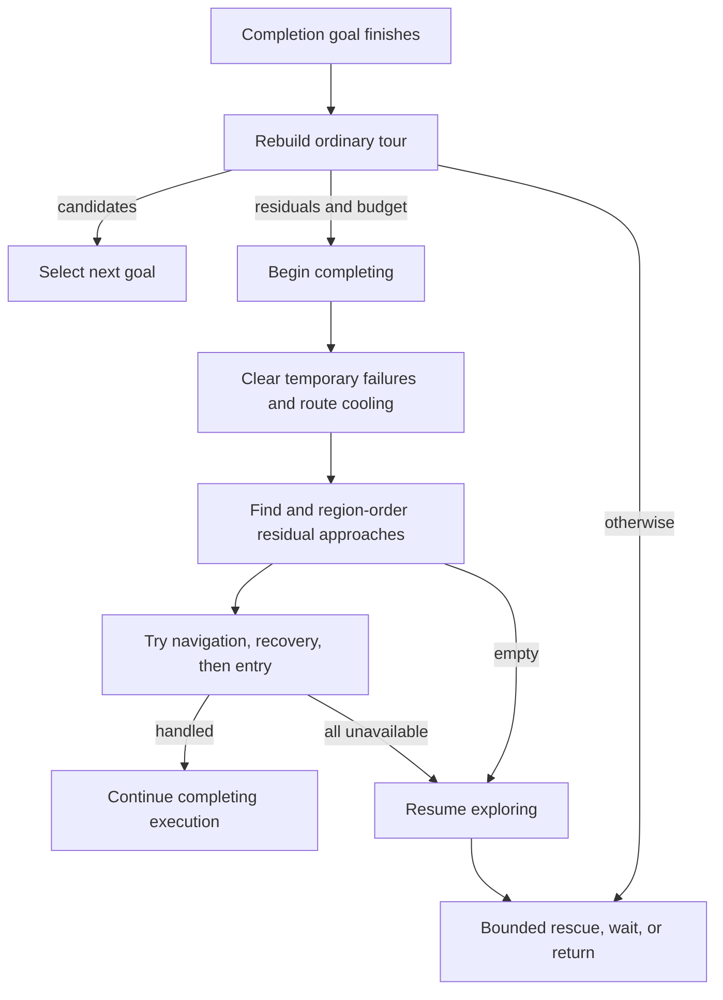
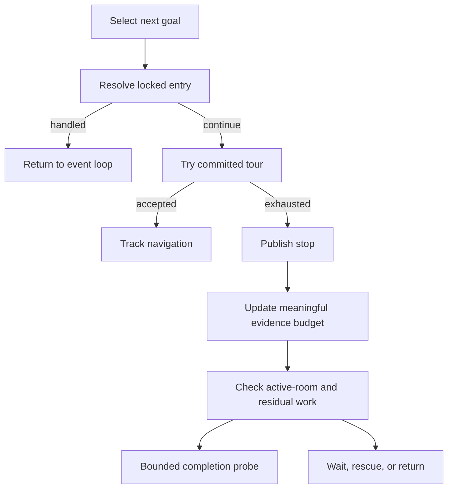

# 模块与源码索引

## 概览

```text
ROS / exploration application → navigation orchestration → planning / control
                                                      └→ costmap
configuration YAML assembly → configuration values / exploration config
planning / control / costmap → configuration values / geometry values
simulation → application（仅 benchmark / replay）
```

当前仍保留 navigation2d_core 聚合 target；已新增 navigation2d_values 与
navigation2d_geometry 边界，尚未把所有概念层拆成独立 target。

## application

- `navigation_system.h/.cc`：唯一产品编排入口；拥有 costmap、planner、controller、目标和调度状态。
- `application/navigation_config.h`：旧 include 兼容入口；值定义在 `configuration/navigation_config.h`。
- `navigation_config.cc`：现有 YAML schema、类型转换和校验，分组解析仍待后续迁移。
- `route_preparation.*`：规划回退、角点验收、签名冷却和平滑流水线，不拥有执行状态。
- `docking_servo.*`：精停进度/姿态迟滞与速度生成，按新目标重置；安全过滤和失败提交仍由导航编排执行。
- `command_safety_pipeline.*`：独立拥有传感器监测和动态预测；借用 Impl 内稳定寿命的配置，先动态否决后消费原始传感器观测，保留 TTC 的原调用位置。
- `execution_watchdog.*`：路线/对齐进度、旋转、安全停止计时、零命令和每目标恢复预算；组合原 CommandStallWatch，三类重置范围保持不同。
- `navigation_failure.*`：失败效果契约；显式保留进度预算耗尽不清路线、精停超时不增加恢复次数等既有语义，状态和路线仍由导航编排单独提交。
- `command_stall_watch.*`：累计位姿/路线/测量速度证据、时间窗与周期预算的唯一写入者。
- `benchmark_runner.cc`：命令行适配器，仅链接 simulation，不进入产品库。

## exploration application 与 ROS 适配

- `application/exploration/mission_lifecycle.*`：启动基准、阶段、启动等待、超时和最终返航验收；缺少回家误差使用 optional，ROS 适配保留原结果文件表示。
- `application/exploration/entry_target.*`：按门宽、已知自由深度和尝试次数选择探入窗口，不消耗预算、不提交目标。
- `entry_coordinator.*`：入口锁、证据、尝试/爬行预算和入室判断；爬行返回阻塞、行驶或最后一个命令，适配器保持先发布末命令再处理退出。
- `escape_execution.h`：脱困命令、截止时间和返航意图的单一所有者；实时雷达修正仍复用 recovery_policy。
- `pose_motion_watch.*`：独立累计位姿运动与停滞时间窗，保留慢速入室保护，不以编码器转动代替平移进展。
- `dispatch_policy.*`：初始路线净空验收、目标超时与三类同步递归重试作用域；快照、目标提交和调度仍由节点编排。
- `return_coordinator.*`：直返、空闲、路径故障和位姿停滞的返航执行顺序及预算；通过 ReturnActions 窄端口执行，不依赖 ROS 或共享任务 Context。
- `return_geometry.*`：只读地图上的回家落点与轨迹点计算，保留原 tie-break 和返回类型；不拥有任务状态。
- `ros/exploration/pose_feedback.*`：定位/真值反馈转换、只读当前位姿、严格超过 0.05 m 的轨迹采样与累计里程；两个订阅路径共用单一状态所有者。
- `ros/exploration/debug_paths.*`：全局/局部/tour 消息构造和显示光标状态，不发布消息、不提交目标。
- `ros/exploration/map_observation.*`：世界坐标线段对实时占用图的查询，同时供显示和爬行判断使用；不归调试模块拥有。
- `ros/autonomous_explorer_node.cc`：仍承担任务/tour 编排、ROS 输入和动作执行，尚未完成薄适配验收。

## costmap

- `grid_2d.*`：加载静态 occupancy grid，负责世界坐标与 cell 坐标转换。
- `layered_costmap.*`：静态层、激光障碍层、清障射线、指数膨胀、滚动窗口和碰撞查询。

## planning

- `global_planner.h`：`GlobalPlanner` 接口及 `Path` 契约。
- `dijkstra_planner.*`、`astar_planner.*`、`theta_star_planner.*`：独立全局规划策略。
- `grid_search.*`：三种策略共享的网格搜索基础设施，不解析配置字符串。
- `planner_factory.*`：旧工厂兼容入口，委托 `application/algorithm_registry.*`。
- `path_geometry.*`、`route_identity.*`、`path_metrics.*`：导航路线的几何、身份与指标。
  `DensifyRoute` 与 grid_search 的 `DensifyPath` 保持各自原有零长度段/朝向语义。

## control

- `local_controller.h`：`LocalController` 接口与 `Twist2d` 控制契约。
- `regulated_pure_pursuit.*`：路径跟踪、曲率/代价调速、加速度限制和前向碰撞预测。
- `dwa_controller.*`：低算力动态窗口速度采样、恒定控制 rollout 和多项代价评分。
- `mppi_controller.*`：控制序列采样、差速批量 rollout、critics 评分和重要性加权更新。

## geometry 与 sensor

- `geometry/pose_2d.h`：以 `Sophus::SE2d` 作为 `Pose2d`，点坐标使用 Eigen。
- `geometry/path_2d.h`、`twist_2d.h`：路径和速度值，不依赖规划/控制接口。
- `geometry/robot_geometry.*`：进程机器人几何的安装、校验与只读查询，不负责 YAML。
- `configuration/vehicle_config.*`：YAML 到机器人/探索配置的适配；旧 geometry include 保留。
- `exploration/exploration_config.h`：独立探索配置值，不拉入 FrontierExplorer。
- `sensor/observations.h`：产品输入的 `LaserScan` 和传感器坐标系 `PointCloud2d`。

## simulation

`NavigationSimulator` 生成雷达观测、积分底盘真值并注入动态障碍。它可以依赖产品核心；
产品核心禁止反向依赖 simulation。

## 验证入口

`test/replay/README.md` 说明如何从真实 ROS 可执行目标构建冻结/候选受控回放，
并通过 A/A→A/B 检查轨迹、非计时输出及性能。该回放替换发布器，不代表 DDS 或板端验收。

测试注册集中在 `test/CMakeLists.txt`，保留原断言开关、Acados/快照编译定义和二进制输出位置；根 CMake 只装配产品库与测试目录。

- `application/exploration/entry_probe_executor`：入口靠近、探测、已入室判定和证据提交的同步流程；引用现有状态所有者，不保存节点或共享可写 Context。`EntryActions` 只提供导航、冷却、房间调度和通知能力。
- `ros/exploration/entry_reporter`：入口事件的 ROS 日志与状态文案；状态发布继续经过节点出口，保持日志/发布先后顺序。

- `application/exploration/tour_execution`：唯一拥有已承诺 tour 队列及版本，向节点提供只读视图；负责构建、房间收尾、候选游标、连续交接和远端救援排序的提交。`mouth_tour_order` 与 `wall_tip_tour_order` 分别计算原有的三段/两段优先级，保留不同的区域与轨迹方向规则。

- `application/exploration/entry_completion`：统一入口确认和房间收尾的顺序，显式区分探测前、爬行、行驶中、近目标及成功/选择入口；保留 12/14 秒冷却的前后顺序，不把过门口计为区域完成。`entry_actions` 是入口能力与通知协议，不保留服务或共享可写状态。

- `application/exploration/dispatch_policy` / `navigation_dispatch`：拥有候选路线的实时占用/净空验收与有界重试顺序；显式区分接受当前准备、接受递归重试与拒绝。适配器负责记录诊断并取消准备、维护冷却签名和提交目标，失败候选不能提前提交任务状态。

- `application/exploration/planning_evidence_budget`：唯一拥有起点/已行轨迹重放意图及米制预算；地图分辨率和轨迹样本不足时保留请求，只在准备证据时消费一次。取消重放意图保留尚未消费的预算，保持原恢复语义。

- `ros/exploration/explorer_parameters`：启动时收集 ROS 参数、环境约束及结果路径，按显式算法注册表验证三种用途的选择；节点持有 const 配置，不再交错声明参数和任务操作。保留原参数/环境解析顺序与默认值，读取不构造算法实例。

### Frontier evidence and memory boundaries

`frontier_types.h` defines mapper grid and goal values without an explorer dependency.
`MapEvidence` owns observation/planning snapshots; borrowed `ObservationGridView` and
`PlanningGridView` separate raw frontier identity from execution geometry. Validated
callers supply matching grid storage and positive planning resolution. Update
notification occurs after the observation copy and before the planning move.

`FrontierTracks` owns observation epochs and representative association; duplicate
candidates in one epoch do not increase persistence. `FrontierVisitMemory` owns
temporary/persistent spatial exclusions and known-cell growth expiry.
`doorway_geometry` calculates clearance and doorway evidence; `live_route_safety`
checks body-swept route samples against occupied cells. Neither grants passage
through occupied mapper evidence. FrontierExplorer still composes extraction,
viewpoint generation and region scheduling; those stages remain to be separated.

### Completion execution

`CompletionExecution` owns residual-probe rounds and the ordering of start/finish
actions. It borrows the explorer, mission lifecycle and tour only for a synchronous
operation. `CompletionActions` supplies navigation/entry/recovery and output effects;
no ROS node or mutable mission context is retained. `completion_reporter` formats
ROS diagnostics separately. Tour interfaces expose value types and forward-declare
the explorer; implementation files include its complete API.



The direct completion replay exercises empty/residual/blocked/finish paths with
real navigation, captured outputs and an independent frozen source/header/core
baseline. Each case owns its ROS context, including early mission shutdown.
It uses the controlled explorer fixture's 0.05 m map and advances past bootstrap.
These controlled probes do not replace complete exploration or board validation.

### Goal selection ownership

`SelectLockedEntry` gates ordinary tour selection. `EntryCoordinator` owns the
mouth lock, pending target, attempts and crawl ticks. Its real-door policy keeps
a latched easy mouth valid after map flooding; live fallback checks corridor
geometry before measuring the gap. A failed probe may consume attempts or clear
the lock, so selection reads the remaining budget after the action returns.
`EntrySelectionResult` explicitly distinguishes handled work from continuing the
tour. A missing pose cannot acknowledge arrival.

`SelectionExhaustion` owns the empty/no-executable cycle counters and last
meaningful known-cell count. A 500-cell gain resets the blocked budget and
reopens residual probes; single-cell changes do not. The existing 2/3/6-cycle
wait and 12-cycle mature-empty confirmation remain unchanged. The stop command
precedes selection status and route clearing; range sensing remains lazy. The
ROS adapter owns time and publications, while the executor owns their order.
Neither executor retains action references or borrows a mutable node context.


